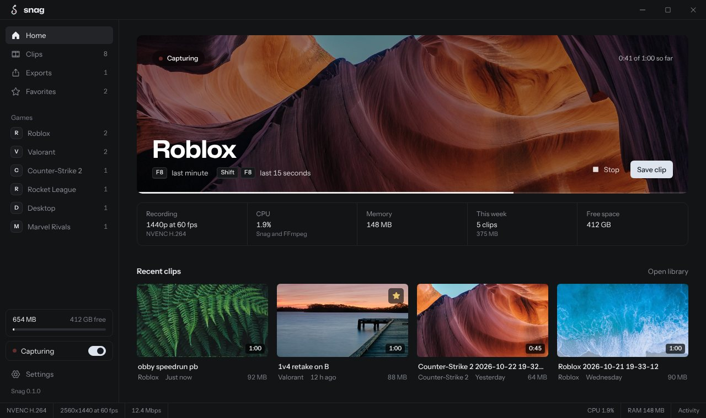
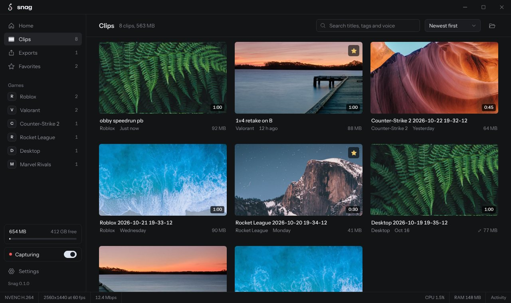
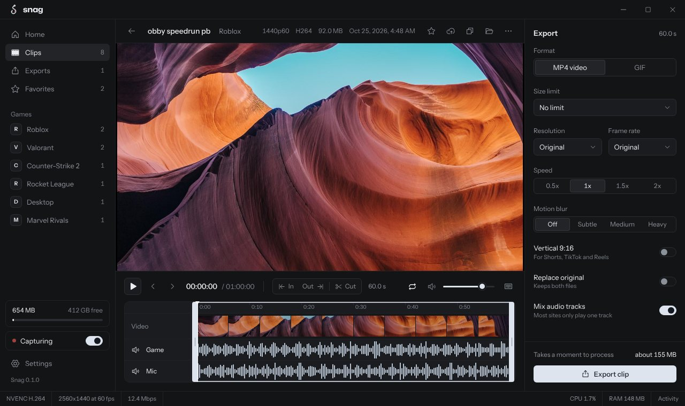

# Snag

A small replay buffer and clip editor for Windows. It keeps the last minute of gameplay ready, in RAM or a hidden folder on disk, and only writes a clip when you press the hotkey. With a GPU encoder it sits well under 1% CPU while you play.



| | |
| --- | --- |
|  |  |

## Download

Grab `SnagSetup.exe` from the [latest release](../../releases/latest). It installs per user, no admin needed, and the first launch walks you through getting FFmpeg and testing your GPU.

The builds aren't code signed yet, so Windows SmartScreen will say it "protected your PC". Click More info, then Run anyway. Some antivirus tools also flag new unsigned apps that use global hotkeys and screen capture. The source is all here if you'd rather build it yourself.

## What talks to the internet

Only these four things, and each one can be switched off or simply not used:

- **FFmpeg download**, from BtbN/FFmpeg-Builds on GitHub, when you press Download.
- **Updates**, a check against this repo's GitHub releases a few times a day. On by default, off in Settings, About.
- **Uploads**, to catbox.moe or your own ShareX uploader, when you upload a clip or turn on uploading new clips.
- **AI titles and voice search**, straight to the provider you picked, only after you add your own key.

## Updates

Snag compares the newest release tag on GitHub (like `v0.2.0`) with its own version. If it's newer, it downloads `Snag.exe` from that release and checks its SHA-256 against the hash GitHub publishes for the file (or `checksums.txt` as a fallback) before swapping it in. The running copy is renamed aside, which Windows allows, so the new version starts the next time Snag opens, or right away with Restart to update. The release notes show once after the update.

Builds made with plain `build.bat` have no repo stamped in and never update themselves.

## Releasing

Push a tag and the workflow in `.github/workflows/release.yml` does the rest: builds on Windows with the tag as the version and this repo as the update source, writes `checksums.txt`, and publishes `SnagSetup.exe`, `Snag.exe` and the checksums as a release with generated notes.

```
git tag v0.2.0
git push origin v0.2.0
```

Edit the release notes on GitHub afterwards if you like, they are what people see in What's new.

## Building

You need Go and Node.js. Then run:

```
build.bat
```

This installs the frontend packages, builds the UI, fetches the Go modules and produces two files:

- `bin\Snag.exe`, the app itself
- `bin\SnagSetup.exe`, an installer that carries the app inside it. It lets you pick a drive (it shows free space on each), sets up shortcuts and start with Windows, can download FFmpeg, and registers an uninstaller in Windows settings that keeps your clips unless you say otherwise. The first build takes a few minutes because Go may download the 1.26 toolchain that Wails v3 needs.

If something misbehaves, build with logs:

```
build.bat debug
```

`bin\Snag-debug.exe` opens with a console that shows what the app is doing.

## First run

Snag needs FFmpeg. The setup screen offers to download a build from BtbN/FFmpeg-Builds (checked against its published SHA-256) into `%LOCALAPPDATA%\Snag\bin`, or you can point it at an `ffmpeg.exe` you already have. On first launch it test-encodes a few frames with every encoder to see which ones work on your GPU, then caches the result.

Default hotkeys:

| Action | Key |
| --- | --- |
| Save clip | F8 |
| Save short clip (last 15 seconds) | Shift+F8 |
| Screenshot | Ctrl+F8 |
| Add bookmark | Alt+F8 |
| Start or stop the buffer | Ctrl+Alt+F8 |

Clips go to `Videos\Snag` and exports to `Videos\Snag\Exports`. Both folders, per-game subfolders and the file name pattern (`{game} {date} {time}` by default, also `{length}`) are in Settings, Storage.

Finished exports are copied to the clipboard, so Ctrl+V in Discord attaches the file. Any clip can be copied the same way from its right-click menu or the clip view.

Screenshots go to `Videos\Snag\Screenshots` as PNG and are copied to the clipboard too, unless you turn that off.

When a clip saves, a small popup slides in at a corner of the screen, styled like the app (it carries Instrument Sans inside the exe, loaded privately so nothing gets installed). It is a plain Windows window, not injected into the game, and it is excluded from capture so it never shows up in clips. Uploads show their progress in the same popup.

## Saving space

- **Shrink.** Right-click a clip, select a few, or use the clip view's menu to re-encode it to AV1 (HEVC on GPUs without AV1, the CPU encoder as a last resort). Clips usually end up about half the size. A result that saves less than 10% is thrown away and the original stays. Settings, Storage can do this on its own for clips older than 3, 7, 14 or 30 days. It only runs while no game has focus and nothing else is processing.
- **No repeated footage.** Press save twice within the clip length and the second save extends the first clip instead of writing a second one that repeats the same seconds.
- **Lean audio.** The mic is recorded in mono at 64 kbps, and a mic track that stayed silent for the whole clip is left out.
- **Trim in place.** In the clip view, turn on Replace original before saving a trim. The original goes to the recycle bin.

## Editing

The clip view trims with Set start and Set end (I and O). Cut out (X) removes the marked part and keeps the rest, so you can drop several dead moments from one clip. Removed parts show hatched on the timeline. Click the small x above one to put it back. A clip with cuts gets re-encoded on export.

Select two or more clips in the library and pick Merge to join them into one video in the order you set. Different resolutions and frame rates are scaled to match the first clip.

## Sharing

Right-click a clip (or use the clip view's menu) and pick Upload and copy link. When it finishes, the link is on your clipboard and the popup shows it. Settings, Sharing can upload every new clip on its own and recycle the local file once the link is copied (favorites are always kept).

Catbox is built in: free, 200 MB per file, 20 MB for GIFs, and an optional userhash puts uploads in your account so you can delete them.

Any other host works through a ShareX custom uploader. Import the .sxcu file, or paste its JSON, and pick it under Upload to. Snag supports multipart and binary uploads with Parameters, Headers and Arguments, and reads the link back with `{json:...}`, `{xml:...}`, `{regex:...}`, `{header:...}`, `{response}` and `{responseurl}`, plus `{filename}`, `{random:...}` and `{base64:...}`. Old `$json:...$` style files are converted on import. Two things differ from ShareX because Snag uploads without stopping to ask: `{select:...}` uses its first choice and `{inputbox}` uses its default text. A DeletionURL, if the uploader has one, shows up as Copy delete link on the clip. Imported uploaders live in `%LOCALAPPDATA%\Snag\uploaders`, including any API keys in their headers, the same way ShareX keeps them.

## Discord on its own track

With game audio on, Settings, Audio has a switch that records Discord separately from everything else, so a clip has Game, Voice and Mic tracks you can mute one by one. It uses per-process loopback, which only exists on Windows 11 (build 22000 or newer). On Windows 10, or if Discord is closed when capture starts, Snag records all desktop audio on one track as before and says so in the status bar.

## AI (optional)

Settings, AI takes a key from Groq, Gemini, OpenAI or Anthropic. The key is encrypted with Windows DPAPI, so only your Windows account can read it, and requests go straight from your PC to that provider.

- **Name new clips.** Three frames from each new clip are sent to the model, which returns a short title and a few tags. You can also do it for a single clip from its menu.
- **Search by voice.** The mic or Discord track is transcribed (Groq and OpenAI use their speech-to-text endpoints, Gemini reads the audio directly) and the text becomes searchable in the library. Claude has no audio input, so this switch is off for it.

The default models are listed in `internal/ai/ai.go` and can be changed in Settings.

## How capture works

1. FFmpeg grabs the screen with `ddagrab` (Desktop Duplication), so frames stay on the GPU, and encodes them with NVENC, AMF or Quick Sync.
2. Game audio (WASAPI loopback) and the microphone are captured in Go and fed to FFmpeg through named pipes, one track each. Silence is padded so audio stays locked to the clock when nothing is playing.
3. FFmpeg writes MPEG-TS to stdout with a keyframe every second. Snag splits it at keyframes and keeps only the last N seconds in a ring buffer.
4. Saving dumps that buffer and remuxes it to MP4 without re-encoding, so it takes about a second.

If the GPU path fails to start, Snag falls back to copying frames through system memory, then to GDI capture. The status bar shows which one is active.

Closing the window destroys the webview, so idle memory drops to the Go process and the buffer. The tray icon brings it back.

## Reporting problems

Settings, About, Copy diagnostics puts versions, GPU and driver, encoder test results, capture state and the last log lines on your clipboard, never your keys. The full log is `%LOCALAPPDATA%\Snag\snag.log`, with the previous one kept as `snag.old.log`. The bug template on GitHub asks for the diagnostics.

## Project layout

```
main.go, core.go, service.go   app setup, tray, hotkeys, the service the UI calls
updater.go, diagnostics.go     self update from github releases, bug report text
internal/recorder              capture pipeline, fallbacks, saving, game-focus mode
internal/tsbuf                 MPEG-TS parser and keyframe ring buffer (has a test)
internal/wasapi                WASAPI capture through raw COM calls
internal/winapi                Win32 helpers: named pipes, clipboard, save notice, recycle bin, DPAPI, process list
internal/ai                    clip titles and transcripts through Groq, Gemini, OpenAI or Anthropic
internal/ffmpeg                locate, download, probe encoders, progress parsing
internal/library               clip index, thumbnails, waveforms, storage budget
internal/jobs                  job queue: trim, cuts, fit to size, blur, 9:16, speed, GIF, shrink, merge
internal/mediaserver           loopback HTTP server so video seeking uses range requests
frontend/                      React, Tailwind v4, Radix primitives, Phosphor icons
build/brand                    logo as SVG, transparent PNG and ICO
build/sounds                   save, bookmark and error sounds (synthesised, yours to replace)
```

The UI talks to Go through `Call.ByName("main.SnagService.<Method>")`, so there is no generated bindings step. Running `npm run dev` inside `frontend` opens the UI in a browser with fake data.

## Known limits

- Windows 10 and 11 only.
- The player in the clip view plays the first audio track. Track mutes and volumes apply to exports.
- Motion blur blends frames, so it is much stronger on clips recorded at 120 or 144 fps than at 60.
- Trimming without re-encoding snaps to the nearest keyframe, about one second.
- Snag records a whole display, not a single window. Window capture in FFmpeg goes through GDI, which is slow, misses most games that use the GPU and shows black for fullscreen ones. Doing it properly needs Windows Graphics Capture, which is a larger piece of work.
- A clip that is open in the clip view cannot be shrunk or replaced at the same moment, because Windows will not swap a file another program is reading. The clip view lets go of the file while it trims in place.

## License

MIT, see `LICENSE`. FFmpeg is downloaded separately and keeps its own license. The popup font is Instrument Sans under the SIL Open Font License, included in `internal/winapi/fonts`.
