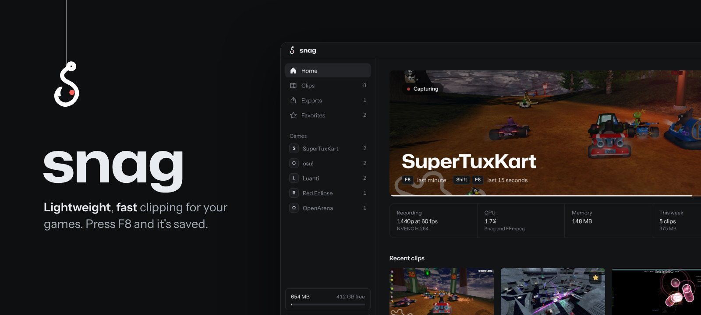
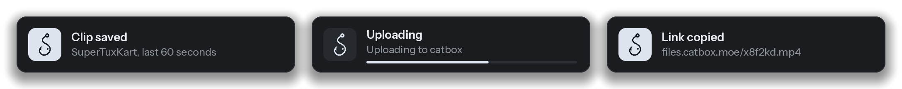

<p align="center">
  
</p>

<p align="center">
  <a href="../../releases/latest"><b>Download</b></a>
  &nbsp;&nbsp;/&nbsp;&nbsp;
  <a href="#build-it-yourself">Build</a>
  &nbsp;&nbsp;/&nbsp;&nbsp;
  <a href="../../issues/new?template=bug_report.yml">Report a bug</a>
</p>

<br>

Snag keeps the last minute of your game ready and saves it when you press **F8**. It's made for PCs where Medal or ShadowPlay feel heavy: the GPU does the encoding, the buffer sits in RAM, and nothing touches your disk until you actually save something.

| | |
|---|---|
| **Under 1% CPU** | with NVENC, AMF or Quick Sync doing the work |
| **0 MB written** | while you play, until you press save |
| **Local** | no account, no cloud, no telemetry |

<br>


## What it does

**Capture.** Fullscreen games included, through Desktop Duplication straight into the GPU encoder. Game audio, mic and Discord can each get their own track, so you can mute your friends later and keep the game sound. Snag can also wait until a game is open before it starts.

**Edit.** Trim, cut out the boring middle, merge clips, speed up, crop to 9:16 for Shorts, add motion blur, or squeeze a clip under Discord's 10 MB limit. Plain trims don't re-encode, so they take about a second.

**Share.** Every save can land on your clipboard as a file, ready for Ctrl+V in Discord. Uploads go to catbox.moe or any ShareX custom uploader (`.sxcu`), and the link is copied for you.

**Stay small.** Old clips can be re-encoded to AV1, which usually halves them. Saving twice in a row extends one clip instead of making two that overlap. A mic track that stayed silent is dropped, and a storage limit clears the oldest clips first, never favourites.

<p align="center">
  
</p>

The popup is a plain Windows window, not something injected into the game, and it's hidden from capture so it never ends up in a clip.


## Hotkeys

| | |
|---|---|
| <kbd>F8</kbd> | save the last minute |
| <kbd>Shift</kbd> <kbd>F8</kbd> | save the last 15 seconds |
| <kbd>Ctrl</kbd> <kbd>F8</kbd> | screenshot |
| <kbd>Alt</kbd> <kbd>F8</kbd> | bookmark the moment |
| <kbd>Ctrl</kbd> <kbd>Alt</kbd> <kbd>F8</kbd> | start or stop capturing |

All of them can be changed. Press <kbd>?</kbd> in the app for the editor keys.

## What goes online

Only these, and each one can be turned off or just left unused:

- **FFmpeg**, from [BtbN/FFmpeg-Builds](https://github.com/BtbN/FFmpeg-Builds), when you click Download
- **Updates**, a check against this repo's releases a few times a day
- **Uploads**, when you upload a clip or turn on uploading new ones
- **AI titles and voice search**, sent straight to the provider whose key you added

## Installing

Get `SnagSetup.exe` from the [latest release](../../releases/latest). It installs for your user only, no admin prompt. The first launch sets up FFmpeg, tests your GPU and shows the hotkeys.

> [!NOTE]
> The builds aren't code signed yet, so SmartScreen will say it protected your PC. Click **More info**, then **Run anyway**. Some antivirus apps are also wary of new unsigned programs that use global hotkeys and screen capture.

Updates install themselves. Snag compares the newest release tag here with its own version, downloads the new `Snag.exe`, checks it against the SHA-256 GitHub publishes for it, and swaps it in on the next launch.

## Build it yourself

You need Go and Node.js.

```
build.bat          bin\Snag.exe and bin\SnagSetup.exe
build.bat debug    bin\Snag-debug.exe, with a console for logs
```

Local builds don't update themselves. `npm run dev` inside `frontend` opens the UI in a browser with fake data (`?mock`).

<details>
<summary><b>Releasing</b></summary>

<br>

Push a tag and GitHub Actions builds both exes, writes `checksums.txt` and publishes the release:

```
git tag v0.2.0
git push origin v0.2.0
```

The release notes are what people see in What's new after updating.

</details>

<details>
<summary><b>How capture works</b></summary>

<br>

1. FFmpeg grabs the screen with `ddagrab`, so frames stay on the GPU, and encodes them with NVENC, AMF or Quick Sync.
2. Game audio, mic and Discord are captured through WASAPI in Go and piped into FFmpeg, one track each. Silence is padded so audio stays in sync when nothing is playing.
3. FFmpeg writes MPEG-TS with a keyframe every second. Snag splits it at keyframes and keeps the last N seconds in a ring buffer.
4. Saving copies that buffer into an MP4 without re-encoding.

If the GPU path won't start, Snag falls back to copying frames through system memory, then to GDI. Closing the window destroys the webview, so the tray process idles on very little RAM.

</details>

<details>
<summary><b>Project layout</b></summary>

<br>

```
main.go, core.go, service.go   app setup, tray, hotkeys, everything the UI calls
updater.go, diagnostics.go     self update from GitHub releases, bug report text
internal/recorder              capture pipeline, fallbacks, saving
internal/tsbuf                 MPEG-TS parser and keyframe ring buffer
internal/wasapi                WASAPI capture through raw COM calls
internal/winapi                Win32: pipes, clipboard, popup, recycle bin, DPAPI
internal/ffmpeg                find, download and test FFmpeg
internal/jobs                  exports, cuts, merges, shrinking
internal/library               clip index, thumbnails, waveforms, storage limit
internal/mediaserver           local server so the player can seek
internal/upload                catbox and ShareX custom uploaders
internal/ai                    titles and transcripts
installer/                     SnagSetup.exe
frontend/                      React, Tailwind, Radix, Phosphor icons
```

</details>

<details>
<summary><b>Known limits</b></summary>

<br>

- Windows 10 and 11 only for now. Linux and macOS are planned.
- Snag records a whole display. Proper window capture needs Windows Graphics Capture, which isn't in yet.
- Discord on its own track needs Windows 11.
- The editor plays the first audio track. Track mutes apply to exports.
- Motion blur blends frames, so it's much stronger on 120 or 144 fps recordings.
- Trims without re-encoding snap to the nearest keyframe, about a second.

</details>

## Bugs

Settings, About, **Copy diagnostics** gives you versions, GPU and driver, encoder results and the last log lines, never your keys. Paste that into a [bug report](../../issues/new?template=bug_report.yml). The full log is in `%LOCALAPPDATA%\Snag\snag.log`.

<br>

<sub>MIT licensed. FFmpeg is downloaded separately under its own license. The popup font is Instrument Sans (SIL OFL). The game footage in the screenshots is from SuperTuxKart, Red Eclipse, osu!, Luanti and OpenArena, all free and open source.</sub>

<sub>This repository includes code and docs written with AI help, alongside code written by hand. All of it gets reviewed before it ships.</sub>
